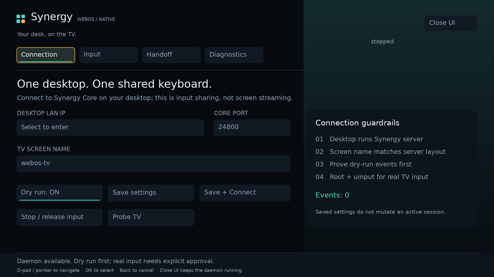
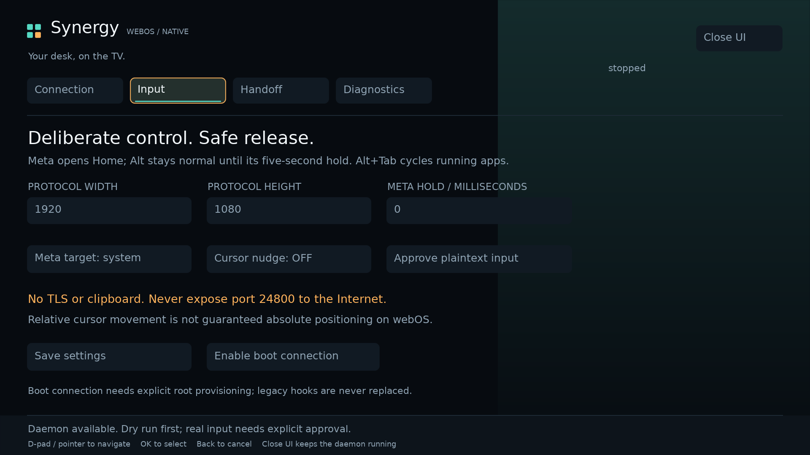
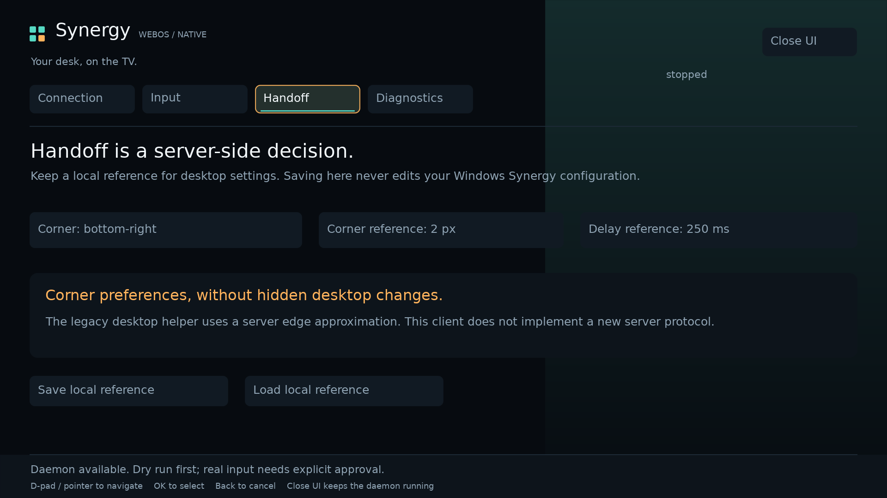

# SynergyWebOS


[](LICENSE)
[](native/docs/VERIFICATION.md)

**One desktop keyboard and mouse. Native control on your webOS TV.**



*Actual SDL2/GLES2 framebuffer capture from the Linux host build, with the local
control daemon idle. Not a browser mockup, LG TV photo, or proof of TV compatibility.*

**0.4.0 native candidate — implemented and host-tested; ARM build and TV validation pending.**

This rebuild starts from the supplied `synergy-tv-0.3.4.tar`, and adds the native
foundation used by Spice Home C++ and SkiFreeWebOS: **C++20, CMake/Ninja, SDL2
window/input handling, raw GLES2 rendering, FreeType text, and ARM32 cross-build
gates**. It is not an HTML app packaged behind a native launcher.

The native runtime contains no Python, Node, browser or Electron component.
Python is used only by host-side tests/audits. The legacy Python/web app is
retained in this source handoff for migration reference, not loaded by the new native app. The dock source,
companion-launch integration and native Apps page have been removed. Keep the
original 0.3.4 archive/package separately for exact rollback.

## Entry points

| Path | Purpose |
|---|---|
| `native/src/ui.cpp` | Native Connection, Input, Handoff and Diagnostics UI |
| `native/src/daemon.cpp` | Separate local control daemon; input can outlive the UI |
| `native/src/protocol.cpp` | Bounded, incremental classic Synergy protocol client |
| `native/src/input.cpp` | Linux uinput backend and non-injecting dry run |
| `native/src/platform.cpp` | Bounded, typed Home/app-switch operations |
| `native/src/ipc.cpp` | UID-checked Unix-domain control socket; no TCP control listener |
| `native/scripts/Build-Desktop.ps1` | PowerShell → WSL native build and tests |
| `native/scripts/build-webos.sh` | Guarded real ARM32 cross-build/stage |
| `native/docs/BUILD.md` | Host, target, packaging and first-TV-test instructions |
| `native/docs/VERIFICATION.md` | What actually ran, and what did not |
| `native/docs/PARITY.md` | 0.3.4 behavior carried forward and deliberate limits |
| `native/docs/SECURITY.md` | Root provisioning and shared-UID trust boundary |
| `spikes/gear-settings/` | LG gear-menu research, read-only SSH probe, and acceptance/rollback plan |
| `.thoughts/HANDOFF.md` | Bounded continuation for the existing local webOS workspace |

App identity remains `dev.canopy.synergywebos`. Native candidate version is
`0.4.0`. The retained legacy source/scripts keep their original 0.3.4 identity (with dock
wiring removed); do
not package the old `app/` directory and label that output a native 0.4.0 build.
The former README is at `docs/legacy/README-0.3.4.md`.

## Native settings



*Input settings: screen geometry, Home-key behavior, app-switch shortcut,
experimental cursor nudge, and explicit plaintext consent. Capture is from the
host build; the host build cannot inject real input.*



*Handoff is a saved local reference. It does not silently modify your Windows
Synergy server or make a client-side hot corner real.*

The dock and standalone app-switcher are **not included**. Windows-key Home and
Alt+Tab remain keyboard shortcuts in the input daemon, not a launcher UI.

## LG gear-button settings spike

The research targets a real **Keyboard & mouse sharing** entry inside LG's own
Quick Settings / All Settings, opening this native app. No supported public
menu-registration API was found in the reviewed LG TV docs. A rooted,
firmware-specific adapter is only a candidate until the C3's actual menu
implementation is inspected. Nothing in this bundle patches or replaces the
gear button, edits LG settings, or installs a system-menu row.

[Read the findings, source references, read-only PowerShell probe and rollback gates](spikes/gear-settings/README.md).
The collector uses existing SSH authorization and writes evidence only on the
PC. It must be run on the target before choosing an insertion strategy.

## Build from PowerShell

Extract to a fresh folder; do not overwrite a dirty working repository:

```powershell
Set-Location 'B:\Temp\@Browser'
tar -xzf .\synergy-tv-native-0.4.0.tar.gz
Set-Location .\synergy-tv-native-0.4.0

# Once, in the WSL distribution used for development:
wsl -- sudo apt-get update
wsl -- sudo apt-get install -y build-essential cmake ninja-build python3 pkg-config libsdl2-dev libfreetype6-dev libjson-c-dev libpng-dev

.\native\scripts\Build-Desktop.ps1
```

Run the daemon in one WSL terminal and the UI in another. From the extracted
project directory inside WSL:

```bash
./native/build/desktop/synergy-daemon
./native/build/desktop/synergy-tv
```

Desktop builds **cannot enable real input**, even when run as root. They can
connect to a real desktop Synergy server in dry-run mode. An empty server is
intentional: set your numeric LAN address and matching screen name in the UI.

Optional compiled Linux x86_64 preview binaries are in `native/bin/linux-x86_64/`.
They require compatible system SDL2, FreeType, json-c, PNG and C++ runtimes.
They are not Windows executables, ARM TV binaries, or standalone installations.
Building locally is the reproducible path.

## Before touching the TV

Use the same verified ARM32 SDK/runtime inputs as the working homescreen/SkiFree
build. The cross-build script rejects host output. The package stage must be
reviewed against the TV's actual libraries and jail permissions.

The native UI does **not** obtain root just by being native. This build's real
input daemon requires an existing authorized root environment, usable uinput,
and explicit local provisioning. Its Unix socket must also be reachable from
the native app jail. That last integration has not been established on a TV.
Do not broaden permissions or disable isolation to make a failed probe green.

The existing Python daemon/autostart must be stopped explicitly before native
real input. The new installer/provisioner does not kill it, overwrite its
configuration, install a root exploit, or replace legacy boot hooks.

## Important limits

Classic protocol 1.4; no TLS, shared clipboard, files or Synergy 3 cloud discovery.
Only numeric private/loopback addresses are accepted. Real plaintext input needs
separate approval. Never expose it to the public Internet.

Input is relative uinput. It does not establish absolute Magic Remote cursor
position. The cursor nudge is experimental and off by default. Handoff controls
save a local reference; they do not secretly edit the Windows server. There is
no dock, app-launcher page, or system-wide overlay in the native app.

No TV installation, root change, Git commit, publication or desktop configuration
change was performed as part of this rebuild.

## Verification and contribution

The native build uses the actual recovered Spice Home runtime/renderer source;
[provenance and licenses](native/NOTICE.md) identify the inherited files.
[Verification](native/docs/VERIFICATION.md) separates compiled/tested behavior
from TV-only acceptance. Badges above are **static snapshot labels**, not a
fabricated remote CI result or a claim of a published release. Screenshot
provenance and reproduction are in [the media notes](docs/media/README.md).

[Build and first-TV gates](native/docs/BUILD.md) ·
[Feature parity](native/docs/PARITY.md) ·
[Security](native/docs/SECURITY.md) ·
[Continuation](.thoughts/HANDOFF.md)

Independent implementation; not affiliated with Symless or LG. The software
shares input, not your desktop display. Preserve upstream attribution and the
MIT notices when reusing the homescreen foundation.
